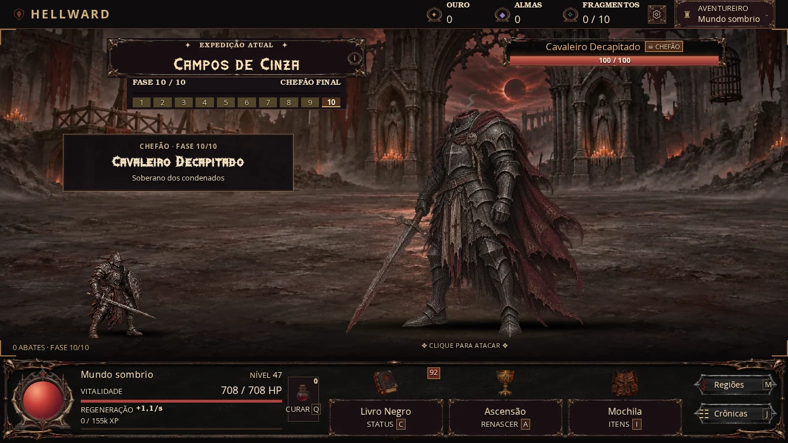
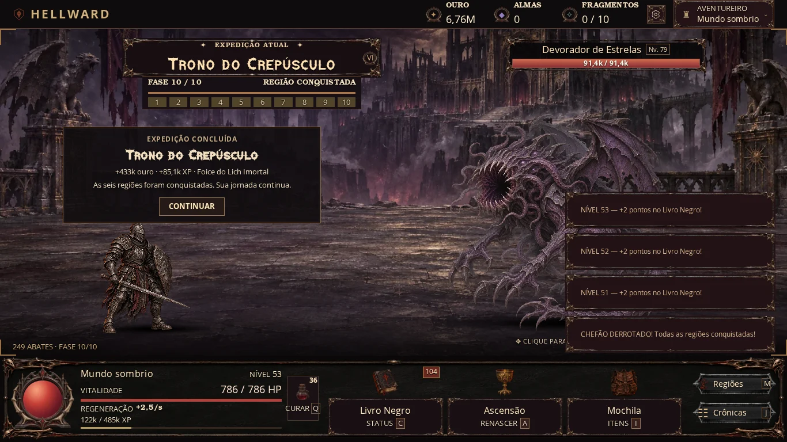

# HELLWARD — itens 7 e 8: atmosfera e ritmo entre fases

## O que mudou

### Item 7

`ATMOSPHERE_CONFIG`, no topo de `world-atmosphere.js`, define cor/opacidade/ritmo da névoa, cor/intensidade/ciclo da luz e tipo, quantidade, tamanho, opacidade e duração das partículas para cada região.

| Região | Partículas visíveis | Luz | Névoa |
|---|---:|---|---|
| Campos de Cinza | 5 cinzas | Cobre discreto, 8 s | Cinza quente; PNG anterior e dois planos CSS |
| Bosque Profanado | 4 folhas secas | Verde frio, 10 s | Musgo esverdeado |
| Criptas Afogadas | 5 flocos espectrais | Azul glacial, 10 s | Mais densa, azul acinzentado |
| Fortaleza de Ferro | 4 partículas de poeira | Ferrugem, 7,5 s | Mais rarefeita |
| Fendas Infernais | 6 brasas ascendentes | Vermelho brasa, 6,5 s | Fumaça quente e escura |
| Trono do Crepúsculo | 4 motes espectrais | Violeta, 9 s | Violeta acinzentado |

Pool fixo de **8 partículas**, máximo padrão visível de **6**; nenhuma criação/remoção por ciclo. Os planos de névoa ficam atrás dos personagens. A névoa PNG existente se move no contêiner próprio quando carregada; o fallback do Passo 0 continua funcionando. Luz e névoa usam apenas `transform`/`opacity`, sem filtros animados, blur ou blending. As partículas usam formas CSS pequenas e estáticas e movimento quantizado; os deslocamentos de fase usam passos inteiros para agrupar atualizações.

A atmosfera anima somente no desktop (mínimo 1000×600). Aba oculta ou painel aberto pausa as animações; movimento reduzido, modo leve ou Efeitos de tela desligados deixam a aparência estática anterior. O código não adiciona loop JS por frame. A rodada de 380 px e controles de toque continua adiada.

### Item 8

- Intro de **1,25 s** para os elites existentes (minibosses/chefes), com nome, título regional e fase. Entrada de **260 ms**, deslocamento horizontal de **2 px em passos inteiros**, sem escala/rotação e com `image-rendering: pixelated`. O ataque continua disponível e interrompe o deslocamento de entrada.
- Aura estática verde para minibosses e dourada para chefes, atrás do sprite. Desligada no modo leve/Efeitos de tela; não pulsa nem esconde o inimigo.
- Morte visual de **180 ms** em inimigos comuns/minibosses; chefes reutilizam a finalização anterior de **300 ms**. Apenas uma apresentação de morte é reutilizada. A barra fica oculta durante essa troca e volta refletindo o inimigo atual.
- Cortina de **340 ms** somente no ambiente, com indicação da nova fase. A intro já inclui a fase quando nasce um elite. Nenhum avanço de câmera/parallax foi adicionado.
- Conclusão de região e conclusão final da expedição mostram ouro efetivamente creditado, XP do combate e o equipamento recebido/conversão na Mochila. O painel dura **6,5 s**, pode ser fechado com Continuar ou ataque e não pausa o jogo. O botão, inclusive via teclado, apenas fecha a apresentação.

**Estado e recompensas permanecem síncronos.** O golpe transbordante continua limitado a 12 inimigos por chamada; cliques e DPS durante a morte continuam sendo processados normalmente. O visual agrupa rajadas muito rápidas e revela o inimigo atual ao fim da morte; não cria uma fila de sprites/transições atrasadas. A morte não depende de callback para conceder loot/XP/ouro. A conquista de um chefe é salva antes de terminar a apresentação. Formato/versão do save, chances de loot, fórmulas de dano/XP/ouro, checkpoints e entrada de ataque/cura/Ascensão foram preservados.

Callbacks de animação e timers só cuidam de apresentação/renderização, com verificação de identidade do registro/dono. Mudança de aba, perfil, viagem, caça ou Ascensão cancela as apresentações antigas. As animações novas respeitam movimento reduzido/Efeitos de tela; a conclusão informativa pode ser mostrada estática. Os grupos anteriores de `FX_CONFIG` foram comparados byte a byte e continuam iguais.

## Arquivos alterados

Produção: `game.js` (integração e métodos de apresentação), `world-atmosphere.js` (configuração/pool/lifecycle), `world-fx.css` (ambiente e apresentação) e `index.html` (novos módulos/cache). Nenhum asset de produção novo foi necessário: a névoa existente é reutilizada e as partículas/luzes são CSS.

Testes: `tests/world-fx.cjs` (novo), `tests/performance.cjs` (seis cenas regionais e rajada de transições) e `tests/scene-layers.cjs` (o HTML de referência antigo agora usa também o game.js de referência correspondente). Documentação: este arquivo, `docs/performance-items-7-8.json` e capturas em `docs/images/`.

## Como testar no computador

1. Percorra as seis regiões em 1366×768 ou 1024×600: observe devagar a névoa e a luz; procure as poucas partículas de cada ambiente. O inimigo e os números devem continuar sendo o foco.
2. Deixe surgir um miniboss/chefe. Leia nome/título/fase e ataque imediatamente: o clique deve funcionar durante a intro; a aura deve distinguir o especial.
3. Mate inimigos clicando rápido. Durante a morte curta, a barra da troca fica oculta; em seguida o nome, sprite e barra correspondem ao alvo atual. Não deve surgir uma fila crescente de animações.
4. Cruze uma fase e derrote um chefe. Confira fase/conquista e os valores na Mochila/HUD. Clique em Continuar repetidamente ou use Espaço: nada é concedido outra vez.
5. Troque de aba ou abra um painel; depois volte. Teste modo leve, Efeitos de tela desligados e `prefers-reduced-motion`. Não deve haver reprodução de apresentações antigas nem acúmulo de partículas.
6. Para repetir a verificação automatizada, rode `node tests/world-fx.cjs`: seis ambientes, intros/auras, rajadas de clique/dano, comparação da economia com a versão anterior, teclado, pausa, perfil e Ascensão.

## Código completo dos trechos alterados

Dentro da classe `Game`, substitua os métodos preexistentes listados abaixo e adicione os novos métodos. Não altere os demais métodos. O objeto completo é reproduzido para permitir copiar sem lacunas; somente `encounter` foi acrescentado a `FX_CONFIG`.

### game.js — FX_CONFIG completo

```js
  const FX_CONFIG = {
    encounter: {deathMs:180,bossDeathMs:300,introMs:1250,entryMs:260,entryPx:2,curtainMs:340,receiptMs:6500,titles:[['Guardião das cinzas','Soberano dos condenados'],['Predador do bosque','Terror das raízes profanadas'],['Oráculo das águas mortas','Rei da cripta afogada'],['Carrasco do ferro','Senhor da fortaleza maldita'],['Devorador das brasas','Soberano das fendas'],['Guardiã do eclipse','O último soberano']]},
    idle: {heroMs:2400,enemyMs:2600,minibossMs:2800,bossMs:2900,heroPx:1,enemyPx:2,minibossPx:1,bossPx:1,heroPhaseMs:700,phaseSpreadMs:1200},
    orb: {lowEnter:.30,lowExit:.33,criticalEnter:.15,criticalExit:.18,lowMs:1800,criticalMs:1200,pulseSteps:12,normalOpacity:.14,lowMin:.2,lowMax:.55,criticalMin:.3,criticalMax:.8,normalColor:'196 107 114',lowColor:'219 161 90',criticalColor:'250 92 88'},
    numbers: {durationMs:760, enemyLimit:8, heroLimit:5, normalRem:1.44, criticalRem:1.88, heroRem:1.38, jitterRem:.75, riseRem:2, pop:1.18},
    impact: {heroBackPx:3,heroForwardPx:10,heroMs:220,criticalHeroMs:250,enemyPx:3,criticalEnemyPx:5,enemyMs:180,criticalEnemyMs:240,contactMs:66,criticalContactMs:75,slashRem:4.5,criticalSlashRem:6,enemyAttackPx:8,heroHurtPx:5,enemyAttackMs:220,heroHurtMs:260,gapMs:110, criticalGapMs:700, holdMs:50, flashMs:80, finalFlashMs:160, finalMs:300, shakePx:3, shakeMs:140, sparkLimit:12, sparks:4, criticalSparks:7, finalSparks:12, sparkMs:300, sparkTravelRem:2.5},
    healthTrail: {
      enabled: true,
      delayMs: 500,
      durationMs: 420,
      easing: 'cubic-bezier(0.2, 0.7, 0.3, 1)'
    }
  };
```

### game.js — constructor completo

```js
    constructor() {
      this.state = null;
      this.profileId = null;
      this.tab = 'upgrades';
      this.buyQuantity = 1;
      this.attributeQuantity = 1;
      this.huntSelection = null;
      this.inventoryFilter = 'all';
      this.inventorySort = 'new';
      this.sellRarity = 'low';
      this.lastFrameAt = 0;
      this.lastCoreRender = 0;
      this.lastPanelRender = 0;
      this.lastZoneRendered = -1;
      this.lastEventRendered = '';
      this.enemyHealthTrail = null;
      this.heroHealthTrail = null;
      this.combatNumbers = {enemy:new Map(),hero:new Map()};
      this.combatNumberSequence = {enemy:0,hero:0};
      this.numberPool={enemy:[],hero:[]};
      this.combatNumberAnchors = {};
      this.combatVisuals = new Map();
      this.configureAtmosphereFX();
      this.prepareIdle($('combatHero').querySelector('.actor-idle'),$('combatHero').querySelector('img'));
      this.vitalityState='normal';this.vitalityOwner=null;
      this.sparkCursor=0;
      this.sparkNodes=Array.from({length:FX_CONFIG.impact.sparkLimit},()=>{const n=document.createElement('i');n.className='combat-spark';n.setAttribute('aria-hidden','true');$('battlefield').append(n);return n;});
      document.addEventListener('hellward:screen-effects',()=>{this.clearCombatVisuals();this.cancelEncounterFX();if(this.state)this.renderCore();});
      this.lastCombatImpactAt = -Infinity;
      this.lastCriticalImpactAt = -Infinity;
      document.documentElement.toggleAttribute('data-combat-idle-paused',document.hidden);
      this.reducedCombatMotion = matchMedia('(prefers-reduced-motion: reduce)');
      this.reducedCombatMotion.addEventListener('change',()=>{
        this.resetEnemyHealthTrail();
        this.resetHeroHealthTrail();
        this.clearCombatNumbers();
        this.clearCombatVisuals();
        this.cancelEncounterFX();
        if(this.state)this.renderCore();
      });
      this.setupEncounterFX();
      this.startedLoop = false;
      this.loopTimer = 0;
      this.arenaSize = {width:800,height:400};
      // Reuse one observer: cache anchors only when the arena/actors/event resize.
      // Floating numbers never measure layout on hits or animation frames.
      const combatResize=new ResizeObserver(()=>this.cacheCombatNumberAnchors());
      for(const id of ['battlefield','combatHero','attackTarget','eventOverlay'])combatResize.observe($(id));
      this.sessionStorage = new Map();
      this.storageAvailable = this.testStorage();
      this.resetLegacyProgress();
      this.bindEvents();
      document.querySelectorAll('[data-status-icon]').forEach(node=>paintIcon(node,ART.status[node.dataset.statusIcon]));
      this.showAuth();
      window.addEventListener('pagehide',()=>this.save());
      window.addEventListener('beforeunload',()=>this.save());
      document.addEventListener('visibilitychange',()=>{
        this.cancelEncounterFX();
        document.documentElement.toggleAttribute('data-combat-idle-paused',document.hidden);
        this.resetEnemyHealthTrail();
        this.resetHeroHealthTrail();
        this.clearCombatNumbers();
        this.clearCombatVisuals();
        if (this.state) {this.stepClock();this.save();if(document.hidden)this.stopLoop();else{this.renderCore();this.startLoop();}}
      });
      setInterval(()=>this.save(),SAVE_INTERVAL);
    }
```

### game.js — showAuth completo

```js
    showAuth() {
      this.cancelEncounterFX(true);
      this.stopLoop();
      this.resetEnemyHealthTrail();
      this.resetHeroHealthTrail();
      this.clearCombatNumbers();
      this.clearCombatVisuals();
      const profiles=this.getProfiles().sort((a,b)=>b.lastPlayed-a.lastPlayed);
      const list=$('profileList');
      list.replaceChildren();
      for (const profile of profiles) {
        const btn=document.createElement('button');btn.type='button';btn.className='saved-profile';
        const name=document.createElement('strong');name.textContent='♜  '+profile.name;
        const detail=document.createElement('small');detail.textContent='CONTINUAR  ❯';
        btn.append(name,detail);btn.addEventListener('click',()=>this.openProfile(profile));list.append(btn);
      }
      prop('savedProfiles','hidden',profiles.length===0);
      prop('authScreen','hidden',false);
      $('authScreen').dispatchEvent(new Event('menu-open'));
      document.dispatchEvent(new CustomEvent('hellward:scenechange',{detail:{scene:'menu'}}));
      $('newProfileName').value='';
    }
```

### game.js — activate completo

```js
    activate(profile,state) {
      this.cancelEncounterFX(true);
      this.resetEnemyHealthTrail();
      this.resetHeroHealthTrail();
      this.clearCombatNumbers();
      this.clearCombatVisuals();
      this.state=state;
      this.huntSelection=null;
      this.profileId=profile.id;
      this.lastZoneRendered=-1;
      this.lastEventRendered='';
      this.lastFrameAt=now();
      prop('authScreen','hidden',true);
      document.dispatchEvent(new CustomEvent('hellward:scenechange',{detail:{scene:'battle'}}));
      const seconds=Math.min(MAX_OFFLINE_SECONDS,Math.max(0,(now()-state.lastSeen)/1000));
      const offline=this.grantOffline(seconds);
      state.lastSeen=now();
      if (state.event && state.event.expiresAt <= now()) state.event=null;
      state.nextEventAt=now()+this.nextEventDelay();
      state.nextEnemyAttackAt=now()+enemyAttackInterval(state.mob);
      if(state.deadUntil && state.deadUntil<=now()) {state.deadUntil=0;state.heroHp=this.bonuses().maxHp;state.mob=freshMob(state);}
      this.touchProfile();
      this.renderEverything();
      this.addLog('Uma chama ressurge nas ruínas. A caçada continua.','✦','good');
      if (!this.storageAvailable) this.toast('Modo temporário: seu navegador bloqueou o armazenamento. Exporte backups JSON.');
      if (offline.kills>0) {
        this.addLog(`Seu ritual venceu ${fmt(offline.kills)} inimigos durante sua ausência.`, '☽', 'good');
        this.dialog('As cinzas guardaram sua jornada',`${state.name}, seus rituais continuaram a colher poder enquanto você esteve ausente.`,[{text:'RETOMAR A CAÇADA',primary:true}],'☽',{kind:'offline',duration:this.formatDuration(seconds),kills:offline.kills,gold:offline.gold,xp:offline.xp});
      }
      this.save();
      this.startLoop();
    }
```

### game.js — killHero completo

```js
    killHero() {
      this.cancelEncounterFX(true);
      const s=this.state;
      if(s.deadUntil)return;
      s.heroHp=0;
      s.deadUntil=now()+8000;
      this.clearCombatVisuals();
      s.event=null;
      s.mob=freshMob(s);
      s.nextEventAt=now()+this.nextEventDelay();
      this.addLog('Você foi derrotado! O inimigo recuperou toda a vida. Retorno em 8 segundos.','☠','epic');
      this.toast('☠ DERROTADO — Retorno em 8 segundos.');
      this.renderEvent();this.save();
    }
```

### game.js — attack completo

```js
    attack() {
      this.closeExpeditionReceipt();
      this.stopEncounterAnimation('entry');
      if(this.state?.deadUntil)return;
      if(!this.state || !$('dialogBackdrop').hidden || !$('hudBackdrop').hidden)return;
      const b=this.bonuses(),critical=Math.random()<b.crit;
      const hit=multiply(b.click,critical?b.critDamage:1);
      this.damageMob(hit,true,critical);
      this.renderCore();
    }
```

### game.js — damageMob completo

```js
    damageMob(amount,fromClick,critical) {
      const s=this.state;
      if(!s || s.deadUntil || amount<=0)return;
      if(fromClick && !this.encounterHold){this.floatNumber(`${critical?'CRÍTICO! ':''}−${fmt(amount)}`,critical?'crit':'');this.playCombatImpact(critical,amount,s.mob.maxHp);}
      let remaining=amount;
      let chain=0;
      while(remaining>0 && chain++<12){
        const mob=s.mob;
        if(!mob || mob.hp<=0){s.mob=freshMob(s);continue;}
        if(remaining<mob.hp){mob.hp=Math.max(0,mob.hp-remaining);break;}
        remaining-=mob.hp;
        mob.hp=0;
        this.killMob();
      }
    }
```

### game.js — killMob completo

```js
    killMob() {
      const s=this.state;
      const defeated=s.mob;
      const kind=defeated.kind||'normal';
      const name=defeated.name;
      const from={zone:s.zone,stage:combatStage(s),cleared:progressAt(s).cleared,gold:s.gold};
      const visible=this.encounterSeenMob===defeated && !this.encounterHold;
      if(kind==='boss' && visible)this.playHitDecorations(true,true);
      this.beginEncounterDeath(defeated,from,visible);
      const multiplier=kind==='boss'?18:kind==='miniboss'?7:1;
      const gold=Math.floor(multiply(multiply(rewardGold(s),multiplier),this.bonuses().gold));
      const xp=Math.floor(multiply(rewardXp(s),kind==='boss'?14:kind==='miniboss'?6:1));
      this.awardGold(gold);
      s.runKills++;s.lifetimeKills++;s.zoneKills[s.zone]++;
      this.awardXp(xp);
      const progress=progressAt(s);
      let travelNext=false;
      if(kind==='miniboss'){
        progress.minibossDefeated=true;
        progress.stage=6;progress.kills=0;
        this.dropMaterial(3);
        if(Math.random()<.4)this.awardEquipment(weightedPick(['incomum','raro','epico'],[80,19,1]));
        this.addLog(`MINIBOSS ${name} vencido! Fase 6 desbloqueada. +${fmt(gold)} ouro e +${fmt(xp)} XP.`,'⚔','epic');
        this.toast('✦ MINIBOSS VENCIDO! A fase 6 foi liberada!','epic');
      }else if(kind==='boss'){
        progress.bossDefeated=true;progress.cleared=true;progress.stage=10;progress.kills=10;
        this.dropMaterial(5);
        const trophy=this.awardEquipment(weightedPick(['raro','epico','lendario'],[90,9,1]),3);
        if(!from.cleared)this.pendingExpeditionReceipt={owner:s,zone:from.zone,gold:Math.max(0,s.gold-from.gold),xp,trophy:trophy?.name||'Tesouro convertido conforme a Mochila',final:from.zone===ZONES.length-1};
        this.addLog(`CHEFÃO ${name} DERROTADO! ${ZONES[s.zone].name} foi conquistada! +${fmt(gold)} ouro e +${fmt(xp)} XP.`,'◆','epic');
        this.toast(`CHEFÃO DERROTADO! ${s.zone===ZONES.length-1?'Todas as regiões conquistadas!':'Nova região liberada!'}`,'epic');
        travelNext=s.zone<ZONES.length-1;
      }else{
        if(s.farmStage!=null)s.farmKills=(s.farmKills+1)%ENEMIES_PER_PHASE;
        else if(!progress.cleared){
          progress.kills++;
          if(progress.kills===ENEMIES_PER_PHASE){
            if(progress.stage===5){
              this.addLog(`Os dez inimigos da fase 5 caíram. O MINIBOSS surgiu!`,'☠','rare');
              this.toast('⚠ MINIBOSS — Uma criatura poderosa bloqueia o caminho!');
            }else if(progress.stage===10){
              this.addLog(`Os dez inimigos da fase 10 caíram. O CHEFÃO FINAL despertou!`,'☠','epic');
              this.toast('⚠ CHEFÃO DA REGIÃO! Prepare seus golpes!','epic');
            }else{
              progress.stage++;progress.kills=0;
              this.addLog(`FASE ${progress.stage} liberada em ${ZONES[s.zone].name}!`,'✦','good');
            }
          }
        }
        this.rollCombatLoot();
        this.addLog(`${name} derrotado. +${fmt(gold)} ouro · +${fmt(xp)} XP.`,'⚔');
      }
      if(!s.event && now()-s.lastEventAt>17000 && Math.random()<(.029+s.skills.r3*.007))this.spawnEvent();
      if(travelNext){
        const previousZone=ZONES[s.zone].name;
        s.zone++;
        s.event=null;
        s.nextEventAt=now()+this.nextEventDelay();
        this.lastZoneRendered=-1;
        this.addLog(`✧ ${previousZone} concluída. Você avançou para ${ZONES[s.zone].name}!`,'⚑','good');
        this.toast(`REGIÃO ${ZONES[s.zone].rune} — ${ZONES[s.zone].name}`,'good');
      }
      s.mob=freshMob(s,defeated.name);
      s.nextEnemyAttackAt=now()+enemyAttackInterval(s.mob);
      if(this.encounterHold)this.encounterHold.targetMob=s.mob;
      this.renderCore();
      if(!this.encounterHold){this.presentPhaseChange(from);this.presentExpeditionReceipt();}
      if(kind==='boss' && !from.cleared)this.save();
      if(!$('hudBackdrop').hidden && (this.tab==='inventory'||this.tab==='zones'))this.renderPanel();
    }
```

### game.js — performAscension completo

```js
    performAscension(gain) {
      this.cancelEncounterFX(true);
      const s=this.state;
      s.souls=add(s.souls,gain);
      s.level=1;s.xp=0;s.gold=0;s.zone=0;s.zoneKills=Array(ZONES.length).fill(0);s.zoneProgress=ZONES.map(freshProgress);
      s.farmStage=null;s.farmKills=0;s.lootDryStreak=ZONES.map(()=>0);
      s.attributes=emptyRanks(ATTRIBUTES);s.upgrades=emptyRanks(UPGRADES);s.runKills=0;s.runGold=0;
      this.huntSelection=null;
      s.deadUntil=0;s.heroHp=heroMaxHp(s);
      s.rebirths++;s.event=null;s.mob=freshMob(s);s.nextEnemyAttackAt=now()+enemyAttackInterval(s.mob);s.nextEventAt=now()+this.nextEventDelay();
      this.lastZoneRendered=-1;this.lastEventRendered='';
      this.changeTab('ascension');this.renderEverything();
      this.addLog(`RENASCIMENTO ${s.rebirths}: ${fmt(gain)} almas recebidas.`,'◆','epic');
      this.toast(`Você renasceu e conquistou ${fmt(gain)} almas eternas!`,'epic');
      this.save();
    }
```

### game.js — travelTo completo

```js
    travelTo(z) {
      const index=validZone(z);
      if(!unlockedZone(this.state,index)){this.toast(`Região bloqueada. Derrote o chefão da área anterior para entrar.`);return;}
      if(index===this.state.zone)return;
      this.cancelEncounterFX(true);
      this.state.zone=index;
      this.state.farmStage=null;this.state.farmKills=0;
      this.huntSelection=null;
      this.state.mob=freshMob(this.state);
      this.state.nextEnemyAttackAt=now()+enemyAttackInterval(this.state.mob);
      this.state.event=null;
      this.state.nextEventAt=now()+this.nextEventDelay();
      this.lastZoneRendered=-1;
      this.addLog(`Você atravessou para ${ZONES[index].name}.`,'⚑','rare');
      this.changeTab('zones');this.renderEverything();this.save();
    }
```

### game.js — setHuntMode completo

```js
    setHuntMode(stage) {
      const s=this.state;if(!s)return;
      if(stage!==null && (!Number.isInteger(stage)||stage<1||stage>progressAt(s).stage))return;
      this.cancelEncounterFX(true);
      s.farmStage=stage;s.farmKills=0;s.mob=freshMob(s);
      this.huntSelection=stage;
      s.nextEnemyAttackAt=now()+enemyAttackInterval(s.mob);
      this.addLog(stage===null?'A expedição foi retomada no ponto em que parou.':'Caça iniciada na fase '+stage+'. O avanço da expedição será preservado.','⚑','good');
      this.renderEverything();this.save();
    }
```

### game.js — renderCore completo

```js
    renderCore() {
      const s=this.state;
      if(!s)return;
      const b=this.bonuses();
      if(this.encounterHold && (this.encounterHold.owner!==s || this.encounterHold.targetMob!==s.mob || s.deadUntil || !this.encounterMotionEnabled()))this.cancelEncounterFX();
      if(!this.encounterHold)this.renderScene();
      text('goldValue',fmt(s.gold));
      text('prestigeValue',fmt(s.souls));
      const points = attributePoints(s);
      $('attributeBadge').textContent = fmt(points);
      $('attributeBadge').hidden = points === 0;
      $('attributeBadge').parentElement.setAttribute('aria-label', `Livro Negro: status e pontos (C). ${fmt(points)} pontos disponíveis`);
      text('fragmentValue',`${s.shards} / 10`);
      text('profileName',s.name);
      text('playerHeroName',s.name);
      attr('playerHeroName','title',s.name);
      text('combatHeroName',s.name);
      attr('heroHealthProgress','aria-label','Vida de '+s.name);
      attr('codexSummary','aria-label','Status de '+s.name);
      text('levelValue',fmt(s.level));
      const required=xpNeeded(s.level);
      text('xpLabel',s.level===MAX_LEVEL?'NÍVEL MÁXIMO':`${fmt(s.xp)} / ${fmt(required)} XP`);
      const pct=s.level>=MAX_LEVEL?100:Math.max(0,Math.min(100,s.xp/required*100));
      fill('xpFill',pct);
      attr('xpProgress','aria-valuenow',String(Math.round(pct)));
      text('clickStat',fmt(b.click,1));
      text('dpsStat',fmt(b.dps,1));
      text('critStat',fmtPercent(b.crit));
      text('luckStat',fmtPercent(b.luck));
      const hp=Math.min(s.heroHp,b.maxHp);
      text('heroHPText',`${fmt(Math.ceil(hp))} / ${fmt(b.maxHp)} HP`);
      this.renderHeroHealth(hp,b.maxHp);
      fill('lifeOrbFill',hp/b.maxHp*100,'Y');
      fill('arenaHPFill',Math.max(0,Math.min(100,hp/b.maxHp*100)));
      $('heroHPFill').classList.toggle('critical',hp/b.maxHp<.26);
      attr('heroHealthProgress','aria-valuenow',String(Math.round(100*hp/b.maxHp)));
      attr('heroHealthProgress','aria-valuetext',`${fmt(Math.ceil(hp))} de ${fmt(b.maxHp)} pontos de vida`);
      const potionKey=`${s.inventory.length}|${s.inventory.filter(x=>x.kind==='potion').map(x=>x.id+':'+x.qty).join(',')}|${deadForPotion(s,b)}`;
      if(this.potionRenderKey!==potionKey){this.potionRenderKey=potionKey;this.renderQuickPotion();}
      this.renderVitalityMood(hp,b.maxHp);
      const regenText=`+${fmt(b.regen,1)}/s`,naturalRegenText=`+${fmt(b.regenNatural,1)}/s`;
      text('heroRegeneration',regenText);
      attr('heroRegeneration','title',`Recuperação atual: ${regenText}. Natural: ${naturalRegenText}.${s.mob.kind==='normal'?'':' A presença de elites limita a cura passiva.'}`);
      text('combatRegen',regenText);
      text('naturalRegen',naturalRegenText);
      text('defenseStat',fmt(b.defense,1));
      text('hpStat',fmt(b.maxHp));
      const dead=Boolean(s.deadUntil);
      prop('attackTarget','disabled',dead);
      prop('heroRespawn','hidden',!dead);
      text('heroRespawnTime',dead?`${Math.ceil(Math.max(0,s.deadUntil-now())/1000)}s`:'');
      $('combatHero').classList.toggle('defeated',dead);
      text('enemyDamage',fmt(enemyHitDamage(s,b.defense)));
      text('rareDropProgress',`${s.lootDryStreak[s.zone]} / ${RARE_DROP_LIMIT} abates ativos`);
      text('enemyAttackCountdown',dead?'PAUSADO':`${(Math.max(0,s.nextEnemyAttackAt-now())/1000).toFixed(1)}s`);
      text('runKills',fmt(s.runKills));
      text('runGold',fmt(s.runGold));
      text('rebirths',fmt(s.rebirths));
      text('runStatus',`JORNADA ${this.roman(Math.min(30,s.rebirths+1))}`);
      text('currentZoneShort',ZONES[s.zone].rune);
      if(this.encounterHold){this.renderEnemyHealth();text('mobHPText',`${fmt(Math.ceil(s.mob.hp))} / ${fmt(s.mob.maxHp)}`);this.renderEvent();return;}
      const phase=progressAt(s),bossKind=s.mob.kind;
      text('mobName',s.mob.name);
      prop('mobName','title',s.mob.name);
      // A save cannot inject an arbitrary src: choose only from our bundled roster.
      const visualIndex = bossKind === 'boss' ? 6 : bossKind === 'miniboss' ? 5
        : Math.max(0, ZONES[s.zone].names.indexOf(s.mob.name));
      const sprite = monsterSrc(s.zone,visualIndex);
      const proportions=ART.monsters[s.zone][visualIndex];
      const arenaNode=$('battlefield');
      if(arenaNode.dataset.monsterSize!==proportions.size)arenaNode.dataset.monsterSize=proportions.size;
      if(arenaNode.dataset.stature!==String(proportions.height)){
        arenaNode.dataset.stature=String(proportions.height);
        arenaNode.style.setProperty('--monster-stature',proportions.height+'%');
      }
      const artNode = $('monsterArt');
      if(artNode.dataset.family!==MONSTER_FAMILIES[s.zone][visualIndex])artNode.dataset.family=MONSTER_FAMILIES[s.zone][visualIndex];
      if (artNode.dataset.sprite !== sprite) {
        this.combatVisuals.get('enemy')?.cancel();
        this.combatVisuals.delete('enemy');
        artNode.dataset.sprite = sprite;
        const portrait = document.createElement('img');
        portrait.src = sprite;
        portrait.width = 300;
        portrait.height = 315;
        portrait.alt = '';
        portrait.draggable = false;
        portrait.decoding = 'async';
        const idle=document.createElement('span');
        idle.className='actor-idle enemy-idle';
        idle.style.setProperty('--idle-delay',(-((visualIndex*.43+s.zone*.71)%(FX_CONFIG.idle.phaseSpreadMs/1000))).toFixed(2)+'s');
        portrait.addEventListener('load',()=>this.cacheCombatNumberAnchors(),{once:true});
        idle.append(portrait);
        this.prepareIdle(idle,portrait);
        artNode.replaceChildren(idle);
      }
      text('mobLevel',bossKind==='boss'?'☠ CHEFÃO':bossKind==='miniboss'?'✦ MINIBOSS':`Nv. ${fmt(s.mob.level)}`);
      const arena = $('battlefield');
      arena.classList.toggle('boss-fight',bossKind==='boss');
      arena.classList.toggle('miniboss-fight',bossKind==='miniboss');
      arena.classList.toggle('final-boss-fight',bossKind==='boss' && s.zone===ZONES.length-1);
      const frame = $('cameraState');
      frame.textContent = bossKind === 'boss' ? (s.zone===ZONES.length-1 ? 'CONFRONTO FINAL' : 'ARENA DE CHEFÃO') :
        bossKind === 'miniboss' ? 'ARENA DE MINIBOSS' : 'COMBATE • 2D';
      const hunting=s.farmStage!=null,stage=combatStage(s),kills=hunting?s.farmKills:phase.kills;
      text('stageNumber',`FASE ${stage} / 10${hunting?' · CAÇA':''}`);
      text('stageKills',hunting?`${kills} / 10 · REPETINDO`:phase.cleared?'REGIÃO CONQUISTADA':bossKind==='boss'?'CHEFÃO FINAL':bossKind==='miniboss'?'MINIBOSS':`${kills} / 10 INIMIGOS`);
      fill('stageProgressFill',!hunting&&phase.cleared?100:kills*10);
      attr('stageProgressTrack','aria-valuenow',String(!hunting&&phase.cleared?100:kills*10));
      for(const bar of $('stagePips').children){
        const n=Number(bar.dataset.stage);
        bar.classList.toggle('completed',!hunting&&(phase.cleared||n<phase.stage));
        bar.classList.toggle('active',(hunting||!phase.cleared)&&n===stage);
      }
      text('intelMob',s.mob.name);
      text('mobHPText',`${fmt(Math.ceil(s.mob.hp))} / ${fmt(s.mob.maxHp)}`);
      this.renderEnemyHealth();
      text('zoneKillsLabel',`${fmt(s.zoneKills[s.zone])} ABATES · FASE ${phase.stage}/10`);
      const rewardScale=bossKind==='boss'?18:bossKind==='miniboss'?7:1;
      text('intelReward',`+${fmt(Math.floor(multiply(rewardGold(s),rewardScale)*b.gold))} ouro · +${fmt(Math.floor(rewardXp(s)*(bossKind==='boss'?14:bossKind==='miniboss'?6:1)))} XP`);
      text('dropChance',fmtPercent(b.drop));
      text('goldBonus',`+${fmtPercent(b.gold-1)}`);
      text('prestigePreview',fmt(this.previewPrestige()));
      text('inventoryCount',s.inventory.length);
      this.renderMilestone();
      this.renderEvent();
      this.renderEncounterFX();
    }
```

### game.js — setupEncounterFX completo

```js
    setupEncounterFX() {
      this.encounterAnimations=new Map();this.encounterHold=null;this.encounterSeenMob=null;this.encounterSeenState=null;
      this.encounterTimer=0;this.receiptTimer=0;this.pendingExpeditionReceipt=null;
      const node=(tag,cls)=>{const n=document.createElement(tag);n.className=cls;n.hidden=true;return n;};
      this.deathGhost=node('div','encounter-death');this.deathGhost.setAttribute('aria-hidden','true');
      this.deathGhost.innerHTML='<span class="mob-shadow"></span>';
      $('battlefield').querySelector('[data-scene-layer=characters]').append(this.deathGhost);
      this.encounterIntro=node('div','encounter-intro');this.encounterIntro.setAttribute('role','status');this.encounterIntro.innerHTML='<small></small><strong></strong><span></span>';
      this.phaseVeil=node('div','phase-transition-veil');this.phaseVeil.setAttribute('aria-hidden','true');$('arenaCamera').append(this.phaseVeil);
      this.phaseCurtain=node('div','encounter-curtain');this.phaseCurtain.setAttribute('role','status');this.phaseCurtain.innerHTML='<small></small><strong></strong>';
      this.expeditionReceipt=node('section','expedition-receipt');this.expeditionReceipt.setAttribute('role','status');this.expeditionReceipt.innerHTML='<small></small><strong></strong><p></p><p></p><button type="button">CONTINUAR</button>';
      this.expeditionReceipt.querySelector('button').addEventListener('click',()=>this.closeExpeditionReceipt());
      this.expeditionReceipt.querySelector('button').addEventListener('keydown',e=>{if(e.key===' '||e.key==='Enter')e.stopPropagation();});
      $('battlefield').append(this.encounterIntro,this.phaseCurtain,this.expeditionReceipt);
      const pause=()=>{if($('appFrame').inert||document.documentElement.classList.contains('hw-lite')){const held=Boolean(this.encounterHold);this.cancelEncounterFX();if(held&&this.state)this.renderCore();}};
      new MutationObserver(pause).observe($('appFrame'),{attributes:true,attributeFilter:['inert']});
      new MutationObserver(pause).observe(document.documentElement,{attributes:true,attributeFilter:['class']});
    }
```

### game.js — encounterMotionEnabled completo

```js
    encounterMotionEnabled() {
      return Boolean(this.encounterAnimations) && this.combatMotionEnabled() && $('hudBackdrop').hidden && $('dialogBackdrop').hidden && matchMedia('(min-width:1000px) and (min-height:600px)').matches;
    }
```

### game.js — stopEncounterAnimation completo

```js
    stopEncounterAnimation(key) {
      const animation=this.encounterAnimations?.get(key);if(!animation)return;
      this.encounterAnimations.delete(key);animation.cancel();
    }
```

### game.js — animateEncounter completo

```js
    animateEncounter(key,node,frames,duration,done=()=>{}) {
      this.stopEncounterAnimation(key);
      const animation=node.animate(frames,{duration,easing:key==='entry'?'steps(2,end)':'steps(12,end)',fill:'both'});
      this.encounterAnimations.set(key,animation);
      animation.finished.then(()=>{if(this.encounterAnimations.get(key)!==animation)return;this.encounterAnimations.delete(key);animation.cancel();done();},()=>{});
    }
```

### game.js — closeExpeditionReceipt completo

```js
    closeExpeditionReceipt() {
      if(!this.encounterAnimations)return;
      clearTimeout(this.receiptTimer);this.receiptTimer=0;
      if(this.expeditionReceipt&&!this.expeditionReceipt.hidden)this.expeditionReceipt.hidden=true;
      this.stopEncounterAnimation('receipt');
    }
```

### game.js — cancelEncounterFX completo

```js
    cancelEncounterFX(forget=false) {
      if(!this.encounterAnimations)return;
      clearTimeout(this.encounterTimer);this.encounterTimer=0;this.encounterHold=null;
      if(this.encounterAnimations)for(const key of [...this.encounterAnimations.keys()])this.stopEncounterAnimation(key);
      for(const node of [this.deathGhost,this.encounterIntro,this.phaseCurtain,this.phaseVeil])if(node)node.hidden=true;
      $('attackTarget').classList.remove('encounter-hidden');$('battlefield').classList.remove('encounter-hold');
      this.closeExpeditionReceipt();this.pendingExpeditionReceipt=null;
      if(forget){this.encounterSeenMob=null;this.encounterSeenState=null;}
    }
```

### game.js — beginEncounterDeath completo

```js
    beginEncounterDeath(defeated,from,visible) {
      if(this.encounterHold || !visible || !this.encounterMotionEnabled())return;
      const a=this.combatNumberAnchors.enemy,img=$('monsterArt').querySelector('img');
      if(!a?.width || !img?.naturalWidth)return;
      this.stopEncounterAnimation('entry');this.stopEncounterAnimation('intro');this.encounterIntro.hidden=true;
      this.stopEncounterAnimation('curtain');this.stopEncounterAnimation('veil');this.phaseCurtain.hidden=true;this.phaseVeil.hidden=true;
      const record={owner:this.state,targetMob:defeated,from};this.encounterHold=record;
      $('battlefield').classList.add('encounter-hold');text('mobLevel','DERROTADO');
      const duration=defeated.kind==='boss'?Math.max(FX_CONFIG.encounter.bossDeathMs,FX_CONFIG.impact.finalMs):FX_CONFIG.encounter.deathMs;
      if(defeated.kind!=='boss'){
        const ghost=this.deathGhost,{width,height}=this.arenaSize;
        ghost.querySelector('img').src=img.getAttribute('src');
        for(const [key,value]of Object.entries({left:a.x/width*100+'%',top:a.y/height*100+'%',width:a.width/width*100+'%',height:a.height/height*100+'%'}))ghost.style[key]=value;
        ghost.hidden=false;this.animateEncounter('death',ghost,[{opacity:1},{opacity:0}],duration);
      }
      // Only presentation is delayed. State/rewards and overflow damage stay synchronous.
      this.encounterTimer=setTimeout(()=>{
        if(this.encounterHold!==record)return;
        this.encounterTimer=0;this.encounterHold=null;this.deathGhost.hidden=true;this.stopEncounterAnimation('death');
        $('battlefield').classList.remove('encounter-hold');
        if(this.state!==record.owner || document.hidden){this.cancelEncounterFX();return;}
        this.renderCore();this.presentPhaseChange(record.from);this.presentExpeditionReceipt();
      },duration);
    }
```

### game.js — renderEncounterFX completo

```js
    renderEncounterFX() {
      const s=this.state;if(!s)return;
      if(this.encounterSeenState!==s){this.encounterSeenState=s;this.encounterSeenMob=null;}
      if(this.encounterSeenMob===s.mob)return;
      this.stopEncounterAnimation('entry');this.stopEncounterAnimation('intro');this.encounterIntro.hidden=true;
      this.encounterSeenMob=s.mob;
      if(!['boss','miniboss','elite'].includes(s.mob.kind)||s.deadUntil||!this.encounterMotionEnabled())return;
      const c=FX_CONFIG.encounter,banner=this.encounterIntro;
      banner.querySelector('small').textContent=`${s.mob.kind==='boss'?'CHEFÃO':'ELITE'} · FASE ${combatStage(s)}/10`;
      banner.querySelector('strong').textContent=s.mob.name;
      banner.querySelector('span').textContent=c.titles[s.zone][s.mob.kind==='boss'?1:0];banner.hidden=false;
      this.animateEncounter('intro',banner,[{opacity:0},{opacity:1,offset:.1},{opacity:1,offset:.83},{opacity:0}],c.introMs,()=>{banner.hidden=true;});
      const idle=$('monsterArt').querySelector('.actor-idle');
      if(idle)this.animateEncounter('entry',idle,[{opacity:.4,transform:`translateX(${c.entryPx}px)`},{opacity:1,transform:'translateX(0)'}],c.entryMs);
    }
```

### game.js — presentPhaseChange completo

```js
    presentPhaseChange(from) {
      const s=this.state;if(!s||!this.encounterMotionEnabled())return;
      if(from.zone===s.zone&&from.stage===combatStage(s)&&(from.cleared||!progressAt(s).cleared))return;
      this.phaseVeil.hidden=false;this.animateEncounter('veil',this.phaseVeil,[{opacity:0},{opacity:1,offset:.35},{opacity:0}],FX_CONFIG.encounter.curtainMs,()=>{this.phaseVeil.hidden=true;});
      if(this.pendingExpeditionReceipt||s.mob.kind!=='normal')return;
      const node=this.phaseCurtain;node.querySelector('small').textContent=ZONES[s.zone].name;node.querySelector('strong').textContent=`FASE ${combatStage(s)} / 10`;node.hidden=false;
      this.animateEncounter('curtain',node,[{opacity:0},{opacity:1,offset:.2},{opacity:1,offset:.65},{opacity:0}],FX_CONFIG.encounter.curtainMs,()=>{node.hidden=true;});
    }
```

### game.js — presentExpeditionReceipt completo

```js
    presentExpeditionReceipt() {
      const receipt=this.pendingExpeditionReceipt;this.pendingExpeditionReceipt=null;
      if(!this.encounterAnimations||!receipt||receipt.owner!==this.state||document.hidden||!$('authScreen').hidden)return;
      this.closeExpeditionReceipt();this.stopEncounterAnimation('intro');this.stopEncounterAnimation('curtain');this.encounterIntro.hidden=true;this.phaseCurtain.hidden=true;const node=this.expeditionReceipt;
      node.querySelector('small').textContent=receipt.final?'EXPEDIÇÃO CONCLUÍDA':'REGIÃO CONCLUÍDA';
      node.querySelector('strong').textContent=ZONES[receipt.zone].name;
      const rows=node.querySelectorAll('p');rows[0].textContent=`+${fmt(receipt.gold)} ouro · +${fmt(receipt.xp)} XP · ${receipt.trophy}`;
      rows[1].textContent=receipt.final?'As seis regiões foram conquistadas. Sua jornada continua.':`Próxima região: ${ZONES[this.state.zone].name} · FASE ${combatStage(this.state)}/10`;
      node.hidden=false;
      if(this.encounterMotionEnabled())this.animateEncounter('receipt',node,[{opacity:0},{opacity:1}],160);
      this.receiptTimer=setTimeout(()=>this.closeExpeditionReceipt(),FX_CONFIG.encounter.receiptMs);
    }
```

### world-atmosphere.js completo

```js
/* Regional ambience: fixed pool, CSS motion, no frame loop. Desktop first. */
(() => {
  'use strict';
  const ATMOSPHERE_CONFIG = {
    maxParticles:8, particleSteps:120, fogSteps:40, lightSteps:20,
    regions:[
      {name:'Campos de Cinza',fogColor:'139 128 113',fogBack:.06,fogGround:.09,fogMs:42000,lightColor:'142 85 48',lightMin:.68,lightMax:.88,lightMs:8000,particle:{type:'ash',count:5,color:'183 163 138',sizeRem:.12,opacity:.32,durationMs:24000,rise:false}},
      {name:'Bosque Profanado',fogColor:'112 139 123',fogBack:.08,fogGround:.10,fogMs:48000,lightColor:'66 104 74',lightMin:.60,lightMax:.80,lightMs:10000,particle:{type:'leaf',count:4,color:'140 115 72',sizeRem:.24,opacity:.32,durationMs:30000,rise:false}},
      {name:'Criptas Afogadas',fogColor:'120 158 164',fogBack:.10,fogGround:.12,fogMs:50000,lightColor:'46 128 151',lightMin:.60,lightMax:.79,lightMs:10000,particle:{type:'snow',count:5,color:'151 186 190',sizeRem:.12,opacity:.33,durationMs:30000,rise:false}},
      {name:'Fortaleza de Ferro',fogColor:'104 92 83',fogBack:.04,fogGround:.06,fogMs:40000,lightColor:'175 91 35',lightMin:.70,lightMax:.91,lightMs:7500,particle:{type:'dust',count:4,color:'166 124 84',sizeRem:.11,opacity:.30,durationMs:26000,rise:false}},
      {name:'Fendas Infernais',fogColor:'114 74 67',fogBack:.06,fogGround:.08,fogMs:36000,lightColor:'191 46 21',lightMin:.65,lightMax:.90,lightMs:6500,particle:{type:'ember',count:6,color:'236 123 59',sizeRem:.14,opacity:.40,durationMs:24000,rise:true}},
      {name:'Trono do Crepúsculo',fogColor:'137 117 155',fogBack:.07,fogGround:.10,fogMs:46000,lightColor:'101 64 143',lightMin:.62,lightMax:.82,lightMs:9000,particle:{type:'soul',count:4,color:'174 151 189',sizeRem:.13,opacity:.32,durationMs:30000,rise:true}}
    ]
  };
  window.HELLWARD_ATMOSPHERE_CONFIG=ATMOSPHERE_CONFIG;
  const root=document.documentElement,arena=document.getElementById('battlefield'),frame=document.getElementById('appFrame');
  const desktop=matchMedia('(min-width:1000px) and (min-height:600px)'),reduced=matchMedia('(prefers-reduced-motion:reduce)');
  const back=document.createElement('div'),ground=document.createElement('div'),field=document.createElement('div');
  back.className='atmo-fog atmo-fog-back';ground.className='atmo-fog atmo-fog-ground';field.className='atmo-particles';
  for(const node of [back,ground,field])node.setAttribute('aria-hidden','true');
  arena.querySelector('[data-scene-layer=middle]').append(back);
  arena.querySelector('[data-scene-layer=mist]').append(ground,field);
  const particles=Array.from({length:ATMOSPHERE_CONFIG.maxParticles},()=>{const node=document.createElement('i');node.className='atmo-particle';field.append(node);return node;});
  let lastZone=-1;
  function lifecycle(){
    const enabled=desktop.matches&&!reduced.matches&&!root.classList.contains('hw-lite')&&root.dataset.screenEffects!=='off'&&root.classList.contains('hw-game-active');
    const mode=!enabled?'static':document.hidden||frame.inert?'paused':'active';
    if(arena.dataset.atmosphere!==mode)arena.dataset.atmosphere=mode;
  }
  function configure(){
    const zone=Number(arena.className.match(/\bzone-(\d+)\b/)?.[1]||0),c=ATMOSPHERE_CONFIG.regions[zone];
    if(!c)return;
    if(zone!==lastZone){
      lastZone=zone;const p=c.particle;
      const values={'atmo-fog-color':c.fogColor,'atmo-fog-back':c.fogBack,'atmo-fog-ground':c.fogGround,'atmo-fog-ms':c.fogMs+'ms','scene-light':c.lightColor,'atmo-light-min':c.lightMin,'atmo-light-max':c.lightMax,'atmo-light-ms':c.lightMs+'ms','atmo-color':p.color,'atmo-particle-opacity':p.opacity,'atmo-particle-ms':p.durationMs+'ms','atmo-particle-steps':ATMOSPHERE_CONFIG.particleSteps,'atmo-fade-steps':Math.round(ATMOSPHERE_CONFIG.particleSteps*.15),'atmo-core-steps':Math.round(ATMOSPHERE_CONFIG.particleSteps*.70),'atmo-fog-steps':ATMOSPHERE_CONFIG.fogSteps,'atmo-light-steps':ATMOSPHERE_CONFIG.lightSteps};
      for(const [key,value]of Object.entries(values))arena.style.setProperty('--'+key,String(value));
      field.dataset.type=p.type;
      const count=Math.min(ATMOSPHERE_CONFIG.maxParticles,Math.max(0,p.count));
      arena.dataset.ambientParticleCount=String(count);
      particles.forEach((node,i)=>{
        node.hidden=i>=count;
        node.style.left=((i*19+zone*13+7)%96)+'%';node.style.top=p.rise?'78%':'12%';
        node.style.width=node.style.height=p.sizeRem+'rem';
        node.style.setProperty('--mote-dx',((i%3-1)*1.5)+'rem');node.style.setProperty('--mote-dy',p.rise?'-16rem':'16rem');
        // Phase offsets are whole timing steps so sparse particles update together.
        node.style.setProperty('--mote-delay',-(i*17%ATMOSPHERE_CONFIG.particleSteps)*p.durationMs/ATMOSPHERE_CONFIG.particleSteps+'ms');
      });
    }
    lifecycle();
  }
  new MutationObserver(configure).observe(arena,{attributes:true,attributeFilter:['class']});
  new MutationObserver(lifecycle).observe(root,{attributes:true,attributeFilter:['class','data-screen-effects','data-combat-idle-paused']});
  new MutationObserver(lifecycle).observe(frame,{attributes:true,attributeFilter:['inert']});
  for(const media of [desktop,reduced])media.addEventListener('change',lifecycle);
  document.addEventListener('visibilitychange',lifecycle);
  window.addEventListener('pagehide',()=>{arena.dataset.atmosphere='paused';});
  configure();
})();
```

### world-fx.css completo

```css
/* Atmosphere stays below characters and HUD in the Step 0 slots. */
.atmo-fog,.atmo-particles{position:absolute;pointer-events:none;user-select:none;display:none}
.atmo-fog-back{inset:32% -2% 27%;background:radial-gradient(ellipse at 18% 60%,rgb(var(--atmo-fog-color)/var(--atmo-fog-back)),transparent 70%),radial-gradient(ellipse at 82% 70%,rgb(var(--atmo-fog-color)/var(--atmo-fog-back)),transparent 72%)}
.atmo-fog-ground{inset:68% -2% 0;background:radial-gradient(ellipse at 25% 74%,rgb(var(--atmo-fog-color)/var(--atmo-fog-ground)),transparent 73%),radial-gradient(ellipse at 78% 84%,rgb(var(--atmo-fog-color)/var(--atmo-fog-ground)),transparent 75%)}
.atmo-particles{inset:0;overflow:hidden}
.atmo-particle{position:absolute;display:block;background:rgb(var(--atmo-color));border-radius:50%;opacity:0;pointer-events:none}
.atmo-particles[data-type=leaf] .atmo-particle{border-radius:0;clip-path:polygon(0 45%,75% 0,100% 70%,30% 100%)}
.atmo-particles[data-type=soul] .atmo-particle{border-radius:0;clip-path:polygon(50% 0,100% 50%,50% 100%,0 50%)}
.atmo-particles[data-type=snow] .atmo-particle{border-radius:0}
html.hw-game-active #battlefield:is([data-atmosphere=active],[data-atmosphere=paused]) .atmo-fog,html.hw-game-active #battlefield:is([data-atmosphere=active],[data-atmosphere=paused]) .atmo-particles{display:block}
html.hw-game-active #battlefield:is([data-atmosphere=active],[data-atmosphere=paused]) .atmo-fog,html.hw-game-active #battlefield:is([data-atmosphere=active],[data-atmosphere=paused])[data-scene-has-mist] [data-scene-layer=mist]>.scene-assets{animation:hw-fog-drift var(--atmo-fog-ms) steps(var(--atmo-fog-steps),end) infinite alternate!important}
html.hw-game-active #battlefield:is([data-atmosphere=active],[data-atmosphere=paused]) .atmo-fog-ground{animation-direction:alternate-reverse!important}
html.hw-game-active #battlefield:is([data-atmosphere=active],[data-atmosphere=paused]) .arena-lighting{animation:hw-regional-light var(--atmo-light-ms) steps(var(--atmo-light-steps),end) infinite!important}
html.hw-game-active #battlefield:is([data-atmosphere=active],[data-atmosphere=paused]) .atmo-particle:not([hidden]){animation:hw-mote-drift var(--atmo-particle-ms) steps(var(--atmo-particle-steps),end) var(--mote-delay,0ms) infinite!important}
html.hw-game-active #battlefield[data-atmosphere=paused] .atmo-fog,html.hw-game-active #battlefield[data-atmosphere=paused] .arena-lighting,html.hw-game-active #battlefield[data-atmosphere=paused] .atmo-particle:not([hidden]),html.hw-game-active #battlefield[data-atmosphere=paused][data-scene-has-mist] [data-scene-layer=mist]>.scene-assets{animation-play-state:paused!important}
#battlefield[data-atmosphere=static] :is(.atmo-fog,.atmo-particles){display:none!important}
@keyframes hw-fog-drift{from{transform:translateX(-.45rem)}to{transform:translateX(.45rem)}}
@keyframes hw-regional-light{0%,100%{opacity:var(--atmo-light-min)}50%{opacity:var(--atmo-light-max)}}
@keyframes hw-mote-drift{0%{opacity:0;transform:translate(0,0);animation-timing-function:steps(var(--atmo-fade-steps),end)}15%{opacity:var(--atmo-particle-opacity);transform:translate(calc(var(--mote-dx) * .15),calc(var(--mote-dy) * .15));animation-timing-function:steps(var(--atmo-core-steps),end)}85%{opacity:var(--atmo-particle-opacity);transform:translate(calc(var(--mote-dx) * .85),calc(var(--mote-dy) * .85));animation-timing-function:steps(var(--atmo-fade-steps),end)}100%{opacity:0;transform:translate(var(--mote-dx),var(--mote-dy))}}
/* The only sprite motion added here is a two-pixel entry; no scale/rotation. */
.encounter-death{position:absolute;pointer-events:none;z-index:10}
.encounter-death img{display:block;width:100%;height:100%;object-fit:contain;object-position:center bottom;image-rendering:pixelated!important}
.encounter-death .mob-shadow{z-index:-1}
.battlefield.encounter-hold .attack-target{opacity:0!important}
.battlefield.encounter-hold .mob-info .hp-track{visibility:hidden}
.encounter-intro,.encounter-curtain,.expedition-receipt{position:absolute;z-index:15;left:clamp(1rem,8%,7rem);top:32%;width:min(35%,25rem);color:#f3dfbf;background:#110e10ed;border:1px solid #8a6745;box-shadow:inset 0 0 0 .18rem #1c1615;padding:.8rem 1rem;text-align:center;pointer-events:none;text-shadow:0 .0625rem .125rem #000}
.encounter-intro small,.encounter-curtain small,.expedition-receipt small{display:block;color:#c5ab87;font:700 .75rem/1.4 Georgia,serif;letter-spacing:.05em}
.encounter-intro strong,.encounter-curtain strong,.expedition-receipt strong{display:block;margin:.25rem 0;font:700 clamp(1rem,1.8vw,1.5rem)/1.2 var(--hud-title-font,Georgia),serif}
.encounter-intro span,.expedition-receipt p{font:.8125rem/1.4 Georgia,serif;margin:.3rem 0}
.encounter-curtain{top:38%;background:linear-gradient(90deg,#100d0df5,#241817ed,#100d0df5)}
.expedition-receipt{top:30%;width:min(38%,28rem);pointer-events:auto}
.expedition-receipt button{margin-top:.5rem;padding:.4rem 1rem;min-height:2rem;background:#251a16;color:#ffe6b7;border:1px solid #9b754c;font:700 .8125rem/1.3 Georgia,serif;cursor:pointer}
.expedition-receipt button:focus-visible{outline:2px solid #e6bd7c;outline-offset:2px}
html.hw-game-active .battlefield:is(.miniboss-fight,.boss-fight) .monster-aura{display:block!important;inset:0;filter:none!important;opacity:.5;z-index:0;background:radial-gradient(ellipse 45% 9% at 50% 94%,#a98a4d66,transparent 80%),radial-gradient(ellipse 38% 50% at 50% 60%,#b4833814,transparent 75%);border:0;animation:none!important}
html.hw-game-active .battlefield.miniboss-fight .monster-aura{background:radial-gradient(ellipse 42% 8% at 50% 94%,#77a89470,transparent 80%),radial-gradient(ellipse 40% 50% at 50% 60%,#75a98b18,transparent 75%)}
html.hw-lite .battlefield .monster-aura,html[data-screen-effects=off] .battlefield .monster-aura{display:none!important}
@media(max-width:999px),(max-height:599px){.encounter-intro,.encounter-curtain{display:none!important}.expedition-receipt{left:5%;top:32%;width:90%}}
@media(prefers-reduced-motion:reduce){.atmo-fog,.atmo-particles{display:none!important}.arena-lighting{animation:none!important}.scene-assets{animation:none!important;transform:none!important}}

.phase-transition-veil{position:absolute;inset:0;z-index:9;pointer-events:none;opacity:0;background:linear-gradient(90deg,#100b16a6,#100b1644,#100b16a6)}
```

### index.html — linhas completas novas/alteradas

```html
  <script src="game.js?v=28" defer></script>
  <script src="world-atmosphere.js?v=1" defer></script>
  <link rel="stylesheet" href="world-fx.css?v=1">
```

Mantenha `world-atmosphere.js` depois de `scene-layers.js`, e `world-fx.css` depois de `scene-layers.css`.

## Verificações

O teste dedicado compara 60 ataques transbordantes rápidos com uma execução da versão anterior, usando a mesma semente e desativando igualmente o RNG cosmético de impacto nas duas execuções. Foram 720 abates com economia, loot, progresso e chaves de save iguais. Também exercita 80 cliques reais no botão durante morte/entrada; aguarda callbacks e verifica ausência de dano/recompensa adicional, nome atual e instâncias únicas da apresentação. Cliques repetidos e Espaço no botão de conclusão não alteram recursos. Todos os efeitos ambientais, inclusive a névoa PNG, têm pausa de animação conferida em aba oculta.

A comparação final de FPS, os resultados brutos e os limites da medição headless estão em `docs/performance-items-7-8.json`. A aparência/sutileza e o desempenho em hardware real ainda precisam da conferência do jogador; a versão móvel permanece adiada.

## Resultados medidos

- **35 cenas**: antes 47–60 FPS; depois 55–60 FPS. A comparação passou nos limites de 3 FPS/5 ms do projeto.
- Os **seis ambientes com névoa/luz/partículas ficaram em 60 FPS**.
- Estresse de abates/transições: **47 → 55 FPS**, p95 **50.0 → 33.3 ms**. Esse cenário já ficava abaixo de 60 FPS antes e melhorou; não é apresentado como 60 FPS garantidos.
- Testes anteriores e os testes novos passaram. Assets de produção: 97, sem ausências/órfãos/duplicatas. Nenhuma imagem de produção foi criada ou substituída nesta rodada.
- Medições em Chromium headless/SwiftShader; a leitura visual e a percepção de fluidez ainda devem ser conferidas no computador de uso. Não foi alegado teste longo de CPU para estes efeitos novos.




