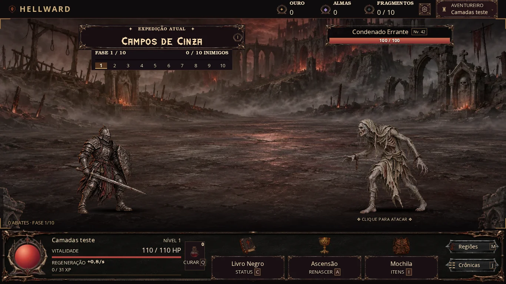

# HELLWARD — Rodada 3, Passo 0: estrutura estática da cena

## Entrega e escopo

Implementada a Parte A e a alternativa inicial da Parte B escolhida pelo usuário: conservar o fundo inteiro atual e criar apenas duas camadas novas em Campos de Cinza. Névoa e primeiro plano foram gerados individualmente, em sequência, usando o fundo original como referência; a névoa foi conferida antes de gerar o primeiro plano. Ambas são PNG RGBA de 1280×720, com enquadramento igual ao fundo desktop. As fontes geradas tinham 1672×941 e foram apenas redimensionadas/comprimidas para integração.

A arte nova vale para inimigos comuns e o miniboss de Campos de Cinza no desktop. Os seis chefes principais, as outras cinco regiões e as variantes estreitas continuam usando seus fundos inteiros atuais. Meio e chão possuem contêineres vazios prontos para futuras imagens; o chão atual continua pintado no fundo original. Não foi simulada uma separação artística que ainda não existe.

**Sem novo movimento:** nenhum listener de ponteiro, parallax, loop de animação, intervalo ou cálculo por frame foi adicionado. `depth` e `parallaxSpeed` são metadados para a etapa futura. As reações de combate, idle, orbe e todos os valores/save do jogo foram preservados; `game.js` e seus grupos `FX_CONFIG` não foram editados. Itens 7 a 10 continuam para depois.

## Ordem da cena

| Ordem | Contêiner | Conteúdo nesta etapa |
|---|---|---|
| 1 | `distant` | Fundo regional inteiro atual e imagens opacas configuradas |
| 2 | `middle` | Vazio, pronto para colunas/escadaria |
| 3 | `ground` | Espaço para chão separado; mantém a iluminação estática anterior |
| 4 | `mist` | Névoa PNG em Campos de Cinza ou névoa estática anterior |
| 5 | `characters` | Herói, inimigo, sombras e botão de ataque existentes |
| 6 | `foreground` | PNG nas bordas inferiores de Campos de Cinza |
| 7 | `effects` | Números, faíscas, cortes, flash e finalização existentes |

As quatro primeiras camadas ficam dentro da câmera decorativa existente; personagens continuam fora dela. Primeiro plano fica abaixo dos efeitos, e a barra do inimigo/eventos ficam acima da pilha de imagens. A interface superior/inferior permanece fora da cena. Camadas decorativas ignoram cliques e não entram na árvore acessível; o ataque continua acessível.

## Configuração e fallback

`SCENE_CONFIG`, no topo de `scene-layers.js`, contém as seis regiões e a lista de imagens por região, com arquivo, profundidade, velocidade futura, desfoque (rem) e opacidade. Suporta arquivos de chefes e variantes estreitas. O desfoque padrão é zero; o limite é 0,125rem, e esta entrega não usa blur nas imagens. As intensidades das duas artes novas são 0,28 e 0,72.

O fundo CSS original fica sempre disponível por baixo. As imagens de uma composição são pré-carregadas e decodificadas antes da montagem. Falta de arquivo, timeout de 6 s, lista vazia, slot inválido, caminho inválido ou dimensões diferentes fazem a composição voltar ao fundo inteiro atual. Nenhuma imagem opcional parcialmente carregada permanece sobre o fundo após uma falha. A iluminação/névoa estáticas anteriores continuam no fallback.

Uma geração de requisição impede que uma resposta atrasada de outra região substitua a cena atual. Falhas saem do cache e podem ser tentadas novamente ao revisitar a área. O cache tem limite de 32 entradas e guarda promessas de dimensões, sem reter objetos `Image`/DOM ou bitmaps decodificados via JavaScript. O módulo observa apenas mudanças de classe da arena e do breakpoint; renderizações repetidas do jogo não recriam as camadas.

Para incluir uma imagem depois, acrescente uma entrada `slot/src/depth/parallaxSpeed/blur/opacity` na lista da região. Use exatamente as mesmas dimensões e câmera das demais imagens. `commonOnly` restringe às arenas comuns/miniboss; `desktopOnly` preserva a variante estreita até haver arte correspondente. Para recarregar uma configuração editada sem trocar de área, dispare `document.dispatchEvent(new Event('hellward:scene-layers-refresh'))` no ambiente de desenvolvimento.

## Arquivos alterados

- `index.html`: sete contêineres, realocação dos mesmos elementos/IDs e carregamento dos dois módulos novos.
- `scene-layers.js`: configuração, pré-carregamento, validação, cache, proteção contra corrida e fallback.
- `scene-layers.css`: posicionamento e ordem estáticos.
- `assets/backgrounds/layers/campos-de-cinza-mist.png` e `campos-de-cinza-foreground.png`: duas imagens novas, sem substituir o fundo original.
- `docs/sprite-review.json`: registro dos dois assets na auditoria existente, mantendo a checagem de inventário completa.
- `tests/scene-layers.cjs`: comparação com o HTML anterior, carregamento/falhas, transparência, proteção do HUD e ausência de trabalho por frame.
- Este documento, `docs/scene-layer-prompts.json` (prompts completos e método) e `docs/performance-scene-layers-step0.json` (medições). A captura de revisão está em `docs/images/scene-layers-step0-preview.webp`.

## Como testar no computador

1. Recarregue e entre em Campos de Cinza: observe a névoa no horizonte e as pedras/pilares das bordas inferiores. Mova o mouse: as imagens novas não se movem. Ataque: números e barra de vida continuam legíveis.
2. Entre nas outras regiões e nas arenas dos chefes: cada uma conserva seu próprio fundo. Confirme que o Imperador continua colossal e que os pés/sombras não mudaram de posição.
3. Em uma cópia local, renomeie temporariamente um dos PNGs e recarregue: o fundo original deve aparecer sem imagens parciais por cima, e o combate deve continuar. Restaure o arquivo e recarregue para voltar à composição.
4. Execute `node tests/scene-layers.cjs` para simular falta de arquivo, dimensões incompatíveis, configuração vazia, timeout e resposta atrasada. O teste também força um primeiro plano opaco com z-index alto e confere a pintura do HUD/da camada de dano acima dele.
5. A revisão foi desktop (1024×600, 1366×768 e 1920×1080). A rodada de 380 px/controles de toque continua adiada.

## Código completo dos arquivos novos

### scene-layers.js

```js
/* Scene preparation only: no parallax, animation loop or gameplay state. */
(() => {
  'use strict';
  const region = (slug, name, overlays = []) => {
    const base = `assets/backgrounds/fast/${slug}`;
    return {name, layers: [
      {slot:'distant', src:base+'.webp?v=dark-14', bossSrc:base+'-boss.webp?v=dark-14',
        mobileSrc:base+'-mobile.webp?v=dark-14', bossMobileSrc:base+'-boss-mobile.webp?v=dark-14',
        depth:0, parallaxSpeed:.1, blur:0, opacity:1},
      ...overlays
    ]};
  };
  const SCENE_CONFIG = {
    loadTimeoutMs:6000, cacheLimit:32, maxBlurRem:.125,
    order:['distant','middle','ground','mist','characters','foreground','effects'],
    regions:[
      region('campos-de-cinza','Campos de Cinza',[
        {slot:'mist',src:'assets/backgrounds/layers/campos-de-cinza-mist.png',depth:.5,parallaxSpeed:.2,blur:0,opacity:.28,desktopOnly:true,commonOnly:true},
        {slot:'foreground',src:'assets/backgrounds/layers/campos-de-cinza-foreground.png',depth:.9,parallaxSpeed:.6,blur:0,opacity:.72,desktopOnly:true,commonOnly:true}
      ]),
      region('bosque-profanado','Bosque Profanado'),
      region('criptas-afogadas','Criptas Afogadas'),
      region('fortaleza-de-ferro','Fortaleza de Ferro'),
      region('fendas-infernais','Fendas Infernais'),
      region('trono-do-crepusculo','Trono do Crepúsculo')
    ]
  };
  // Public configuration is independent of saves; speeds/depth are metadata only.
  window.HELLWARD_SCENE_CONFIG = SCENE_CONFIG;
  const arena = document.getElementById('battlefield');
  const small = matchMedia('(max-width:760px)');
  const slots = new Map(SCENE_CONFIG.order.map(slot => [slot, arena.querySelector(`[data-scene-layer="${slot}"]`)]));
  const effects = slots.get('effects');
  // Game creates the fixed spark pool before this deferred module runs.
  for(const spark of arena.querySelectorAll(':scope>.combat-spark'))effects.append(spark);
  const cache = new Map();
  let generation = 0, lastKey = '';
  const bounded = (n, min, max, fallback) => Number.isFinite(n) ? Math.max(min, Math.min(max,n)) : fallback;
  function load(src) {
    if(cache.has(src))return cache.get(src);
    // Local bundled artwork only. Nothing is read from imported save URLs.
    if(!/^assets\/backgrounds\/[a-z0-9_./-]+\.(png|webp)(\?[a-z0-9_=-]+)?$/i.test(src))return Promise.reject(new Error('invalid-path'));
    const pending = new Promise((resolve,reject) => {
      const image = new Image();
      const timer = setTimeout(() => finish(false),SCENE_CONFIG.loadTimeoutMs);
      let settled = false;
      function finish(ok) {
        if(settled)return;
        settled=true;clearTimeout(timer);image.onload=null;image.onerror=null;
        if(ok)resolve({width:image.naturalWidth,height:image.naturalHeight});
        else reject(new Error('missing-or-invalid-image'));
      }
      image.onload = () => image.decode().then(() => finish(true),() => finish(false));
      image.onerror = () => finish(false);
      image.src = src;
    });
    cache.set(src,pending);
    // Cache dimensions, not Image/DOM objects or decoded bitmap references.
    pending.catch(() => {if(cache.get(src)===pending)cache.delete(src);});
    while(cache.size>SCENE_CONFIG.cacheLimit)cache.delete(cache.keys().next().value);
    return pending;
  }
  function clearImages() {
    for(const slot of slots.values())slot.querySelector(':scope>.scene-assets')?.replaceChildren();
    delete arena.dataset.sceneHasMist;
    arena.dataset.sceneLayerCount='1';
  }
  function fallback(token, reason) {
    if(token!==generation)return;
    clearImages();arena.dataset.sceneMode='fallback';arena.dataset.sceneFailure=reason;
  }
  async function refresh(force=false) {
    const zone = Number(arena.className.match(/\bzone-(\d+)\b/)?.[1] || 0);
    const boss = arena.classList.contains('boss-fight');
    const key = `${zone}:${boss}:${small.matches}`;
    if(!force && key===lastKey)return;
    lastKey=key;const token=++generation;
    clearImages();arena.dataset.sceneMode='loading';delete arena.dataset.sceneFailure;
    const config=SCENE_CONFIG.regions[zone];
    if(!config){fallback(token,'missing-region');return;}
    const layers=config.layers.filter(layer => (!layer.desktopOnly || !small.matches) && (!layer.commonOnly || !boss));
    if(!layers.length){fallback(token,'empty-config');return;}
    const selected=layers.map(layer => ({...layer,src:small.matches ? (boss ? layer.bossMobileSrc || layer.mobileSrc || layer.bossSrc || layer.src : layer.mobileSrc || layer.src) : boss ? layer.bossSrc || layer.src : layer.src}));
    try {
      for(const layer of selected)if(!slots.has(layer.slot) || ['characters','effects'].includes(layer.slot))throw new Error('invalid-slot');
      const sizes=await Promise.all(selected.map(layer => load(layer.src)));
      if(token!==generation)return;
      const first=sizes[0];
      if(sizes.some(size => size.width!==first.width || size.height!==first.height))throw new Error('mismatched-dimensions');
      for(const layer of selected){
        const image=document.createElement('img');
        image.className='scene-layer-image';image.alt='';image.draggable=false;image.decoding='async';
        image.dataset.depth=String(layer.depth);image.dataset.parallaxSpeed=String(layer.parallaxSpeed);image.dataset.blur=String(layer.blur);
        image.style.opacity=String(bounded(layer.opacity,0,1,1));
        const blur=bounded(layer.blur,0,SCENE_CONFIG.maxBlurRem,0);
        if(blur)image.style.setProperty('filter',`blur(${blur}rem)`,'important');
        image.addEventListener('error',()=>fallback(token,'image-render-error'),{once:true});
        image.src=layer.src;
        slots.get(layer.slot).querySelector(':scope>.scene-assets').append(image);
      }
      arena.dataset.sceneMode=selected.length>1?'layered':'single';
      arena.dataset.sceneLayerCount=String(selected.length);
      if(selected.some(layer=>layer.slot==='mist'))arena.dataset.sceneHasMist='true';
    } catch(error) {fallback(token,error.message);}
  }
  new MutationObserver(() => refresh()).observe(arena,{attributes:true,attributeFilter:['class']});
  small.addEventListener('change',()=>refresh());
  document.addEventListener('hellward:scene-layers-refresh',()=>refresh(true));
  refresh();
})();
```

### scene-layers.css

```css
/* Static scene slots. Existing whole regional background is always underneath. */
.scene-plane,.scene-assets{position:absolute;inset:0;pointer-events:none}
.scene-plane{animation:none!important;transform:none;transition:none;isolation:isolate}
.scene-assets{z-index:1}
.scene-layer-image{position:absolute;inset:0;display:block;width:100%;height:100%;object-fit:cover;object-position:center center;pointer-events:none;user-select:none;animation:none!important;transition:none;transform:none;-webkit-user-drag:none}
.arena-camera>[data-scene-layer=distant]{z-index:0}
.arena-camera>[data-scene-layer=middle]{z-index:1}
.arena-camera>[data-scene-layer=ground]{z-index:2}
.arena-camera>[data-scene-layer=mist]{z-index:3}
#battlefield>.scene-characters{z-index:4}
.scene-characters>.attack-target{pointer-events:auto}
#battlefield>.scene-foreground{z-index:8;inset:-3px}
#battlefield>.scene-effects{z-index:20}
#battlefield>.mob-info,#battlefield>.event-overlay,#battlefield>.hero-respawn{z-index:40!important}
#battlefield[data-scene-has-mist] .arena-mist{visibility:hidden}
/* No motion here: depth/speed fields are reserved for the later parallax item. */
```

### index.html — bloco completo do campo de batalha

```html
          <div class="battlefield zone-0" id="battlefield">
            <div class="arena-camera" id="arenaCamera" aria-hidden="true">
              <div class="scene-plane" data-scene-layer="distant"><div class="arena-scenery"></div><div class="scene-assets"></div></div>
              <div class="scene-plane" data-scene-layer="middle"><div class="scene-assets"></div></div>
              <div class="scene-plane" data-scene-layer="ground"><div class="scene-assets"></div><div class="arena-lighting"></div></div>
              <div class="scene-plane" data-scene-layer="mist"><div class="arena-mist"></div><div class="scene-assets"></div></div>
            </div>
            <div class="scene-plane scene-characters" data-scene-layer="characters">
            <div class="combat-hero" id="combatHero" aria-hidden="true"><span class="hero-ground-shadow"></span><span class="actor-idle hero-idle"></span><span class="hero-ground-name" id="combatHeroName">Aventureiro</span></div>
            <button id="attackTarget" class="attack-target" type="button" aria-label="Atacar inimigo"><span class="monster-aura"></span><span class="mob-shadow"></span><span class="monster-art" id="monsterArt" aria-hidden="true"></span><span class="target-hint">✥ CLIQUE PARA ATACAR ✥</span></button>
            </div>
            <div class="scene-plane scene-foreground" data-scene-layer="foreground" aria-hidden="true"><div class="scene-assets"></div></div>
            <div class="scene-plane scene-effects" data-scene-layer="effects" aria-hidden="true">
            <span class="duel-slash" id="duelSlash" aria-hidden="true"></span><span id="targetFlash" class="target-flash" aria-hidden="true"></span><span id="finisherArt" class="finisher-art" hidden aria-hidden="true"><i class="target-flash"></i></span>
            <div class="hero-damage-layer" id="heroDamageLayer" aria-hidden="true"></div>
            <div class="damage-layer" id="damageLayer" aria-hidden="true"></div>
            </div>
            <div class="camera-state" id="cameraState" aria-hidden="true">COMBATE • 2D</div>
            <div class="hero-arena-hp" aria-hidden="true"><span>♥ ERRANTE</span><div><i id="arenaHPFill"></i></div></div>
            <div class="hero-respawn" id="heroRespawn" hidden><strong>☠ VOCÊ FOI DERROTADO</strong><span>Retornando em <b id="heroRespawnTime">8s</b></span><small>O inimigo recuperou a vida. Seus itens e fases foram preservados.</small></div>
            <div class="mob-info"><div class="mob-name-row"><span class="mob-icon">☠</span><strong id="mobName">Condenado</strong><span class="mob-rank" id="mobLevel">Nv. 1</span></div><div class="progress-bar hp-track" id="mobHealthProgress" role="progressbar" aria-label="Vida do inimigo" aria-valuemin="0" aria-valuemax="100" aria-valuenow="100"><div class="hp-damage-trail" id="mobHPDamageTrail" aria-hidden="true"></div><div class="progress-fill hp-fill" id="mobHPFill" aria-hidden="true"></div><span class="hp-numbers" id="mobHPText">30 / 30</span></div></div>

            <div class="event-overlay" id="eventOverlay" hidden><div class="event-ribbon">✦ EVENTO RARO ✦</div><button class="event-button" id="eventTarget" type="button"><span class="event-illustration" id="eventArt" aria-hidden="true">♜</span><span class="event-title" id="eventTitle">Goblin do Tesouro</span><span class="event-instruction">SAQUEAR</span><div class="event-progress-track"><span id="eventHPFill"></span></div><span class="event-clock">⏳ <b id="eventTime">10.0s</b></span></button></div>
            <div class="battle-corner tl"></div><div class="battle-corner tr"></div><div class="battle-corner bl"></div><div class="battle-corner br"></div>
          </div>
```

### index.html — carregamento dos módulos novos

```html
  <script src="scene-layers.js?v=1" defer></script>
  <link rel="stylesheet" href="scene-layers.css?v=1">
```

## Resultados

- 28 cenas desktop comparáveis, incluindo os chefes das seis regiões, ataques, eventos, idle, orbe e barras atrasadas. Antes: **58–60 FPS**; depois: **59–60 FPS**. P95 máximo antes/depois: **16.8/16.8 ms**. Comparação passou na tolerância de 3 FPS/5 ms do projeto.
- Geometria exata em 54 combinações (6 regiões × 3 tipos × 3 resoluções), incluindo o tamanho colossal do Imperador.
- Fallback, timeout e proteção contra respostas antigas foram exercitados; todos mantiveram o jogo funcional. HUD e camada de dano ficaram acima de um primeiro plano opaco de teste.
- Suítes anteriores e balanceamento passaram. Auditoria: **97 assets, 91 rasters e 42 monstros**, sem arquivos ausentes, órfãos ou duplicatas de bytes/pixels.
- Imagens novas estáticas; sem observador/cálculo de animação por frame. A percepção visual e o FPS em hardware real ainda precisam da conferência no computador de uso.


